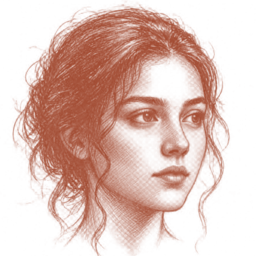

# Posebook

   

Posebook is open-source software for managing venues, recurring programs, participant invitations, bookings, attendance, and public schedules.

The [hosted instance](https://posebook.dblock.org/) serves [Enoch's figure-drawing sessions](https://art.dblock.org/2026/05/25/figure-drawing-at-enochs.html). You can also install and run Posebook for your own venue; see [Contributing](CONTRIBUTING.md) to get started.

Read the story behind Posebook: [The Sunk Cost Fallacy of a Vibe-Coded Custom SaaS](https://code.dblock.org/2026/11/15/the-sunk-cost-fallacy-of-a-vibe-coded-custom-saas.html).

## Key Features

- Separate venue locations and recurring programs.
- Inherited admin, venue-coordinator, and program-coordinator permissions.
- Invitation-based participant registration and independent program bookings.
- Public calendars with time-zone-aware schedules and privacy-respecting participant profiles.
- Participant rescheduling, cancellations, and attendance confirmation.
- Coordinator tools for participant rosters, booking history, and schedule exceptions.
- Profile privacy controls, password recovery, and account management.

## User Guides

- [Accounts and profiles](docs/usage/accounts-and-profiles.md)
- [Venues, programs, and bookings](docs/usage/venues-and-bookings.md)
- [Organizing venues and programs](docs/usage/organizing-a-venue.md)

## Contributing

[CONTRIBUTING.md](CONTRIBUTING.md) covers development setup, tests, and pull request guidance.

## License

Copyright (c) 2026 Vestris LLC. Released under the [MIT License](LICENSE.txt).
