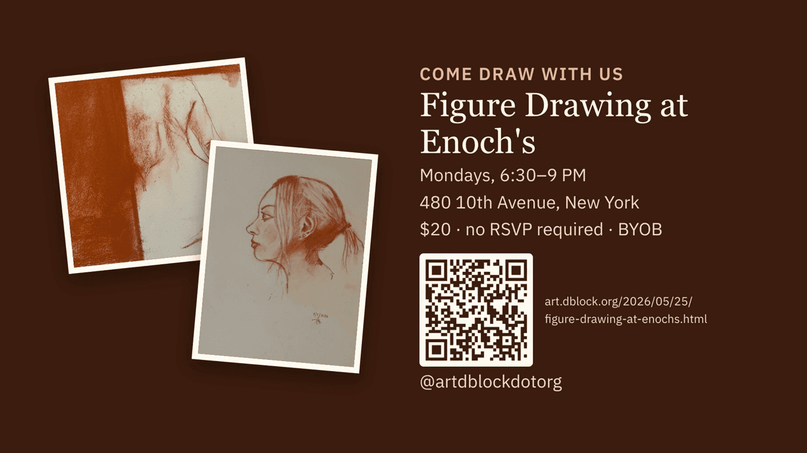

# Posebook Promo Video

[`posebook-promo.mp4`](posebook-promo.mp4) is a one-minute promo in which @dblock tells the story of running Monday night figure drawing at Enoch's in New York, and how Posebook lets models manage their own schedule while it does the reminding. It is 1920×1080 at 30 frames per second, about 61 seconds long, with English captions in the file and in [`posebook-promo.vtt`](posebook-promo.vtt). [`posebook-promo.png`](posebook-promo.png) is a poster frame.

## Contents

| Path                                  | Contents                                                                                                                                               |
| ---                                   | ---                                                                                                                                                    |
| `script.json`, `scenes/`, `theme.css` | Narration, scene HTML, and styles for the [explain-with-video](https://github.com/dblock/dotfiles/tree/master/agents/skills/explain-with-video) skill. |
| `seed.rb`                             | Fictional venue, program, models, bookings, and a placeholder Google Calendar connection for a disposable `posebook_promo` database.                   |
| `capture.mjs`                         | Signs in as the organizer and two models and screenshots the app into `shots/n-*.png`.                                                                 |
| `capture-sources.mjs`                 | Downloads the full-size Instagram images and records a screencast of the [enochs.nyc](https://enochs.nyc/) animation into `tmp/`.                      |
| `prepare.sh`                          | Turns those captures into `sources/` and the cropped `shots/`, and draws the QR code.                                                                  |
| `caption.mjs`, `opening.sh`           | Render the eight-second opening: the Enoch's storefront, the session photo, and the `@artdblockdotorg` caption.                                        |
| `music.py`                            | Generates the background music from scratch with NumPy: 112 BPM, C major, ending on a held chord.                                                      |
| `finish.py`                           | Splices the opening into the skill's video, adds the ducked music and a two-second hold, and shifts captions and chapters.                             |
| `sources/`, `shots/`                  | The captured inputs that the scenes and the opening use.                                                                                               |

## Provenance

The app screens come from a local run of Posebook at 907458c with the synthetic data in `seed.rb`; the model names are fictional and no Google Calendar requests were made. The session photo and both red-chalk drawings were made and posted by @dblock, in Instagram posts [DINSnrgNrN5](https://www.instagram.com/p/DINSnrgNrN5/), [DaAcd1CtZZV](https://www.instagram.com/p/DaAcd1CtZZV/), and [DdK6XYcjeFl](https://www.instagram.com/p/DdK6XYcjeFl/) on [`@artdblockdotorg`](https://www.instagram.com/artdblockdotorg). The storefront animation is from the [Enoch's website](https://enochs.nyc/); the dates on its window posters are blurred. The logo is `../posebook-logo-source.png` at 600 pixels. The narration is the ElevenLabs voice Brian. The music is generated by `music.py`.

## Rebuilding

Rebuilding needs `ffmpeg`, Node 18 or newer, Python 3 with NumPy, Chrome or Chromium for `playwright-core` (set `CHROME` to its binary if Playwright has not installed one), and an ElevenLabs API key for the skill. Run everything from this folder; scratch files go to the ignored `tmp/` and `out/` folders.

1. Run `npm install`.
2. To capture new screens, start a disposable MongoDB replica set and Posebook on port 3031 with `MONGODB_URI` pointing at a `posebook_promo` database, run `bin/rails runner artwork/promo/seed.rb` from the repository root, then `node capture.mjs`.
3. To capture new outside inputs, run `node capture-sources.mjs`.
4. Run `./prepare.sh` to refresh `sources/` and `shots/` from whatever was captured.
5. Run `node ~/.claude/skills/explain-with-video/scripts/make.mjs . all` to narrate and render the scenes into `out/video.mp4`.
6. Run `./opening.sh`, then `python3 finish.py`, then `node ~/.claude/skills/explain-with-video/scripts/make.mjs . page` to rebuild the video page.
7. Copy `out/video.mp4` to `posebook-promo.mp4` and `out/captions.vtt` to `posebook-promo.vtt`.

`finish.py` keeps the skill's original video in `tmp/skill-video.mp4`; delete it before running `finish.py` again after a new `make.mjs . all`.
